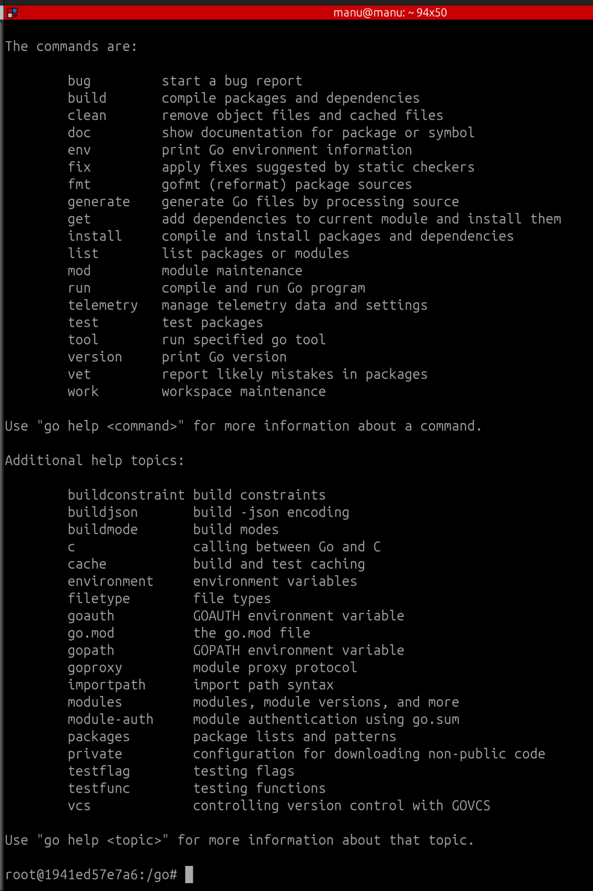
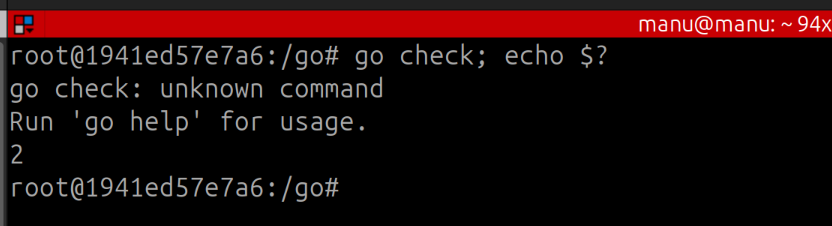
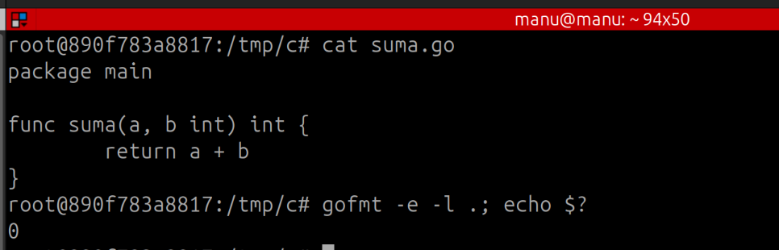
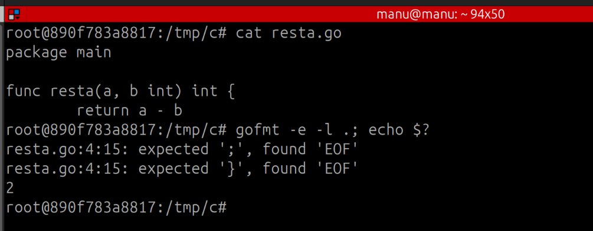
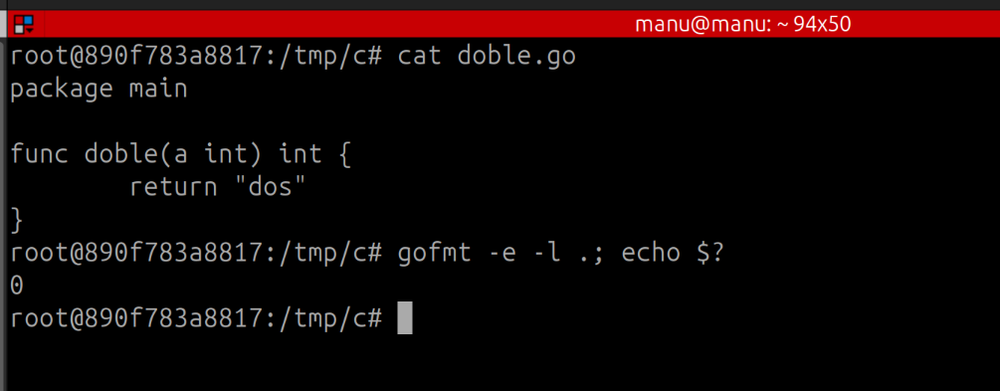
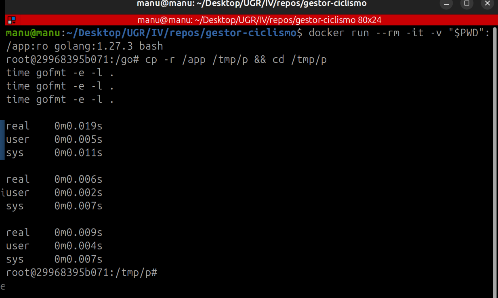
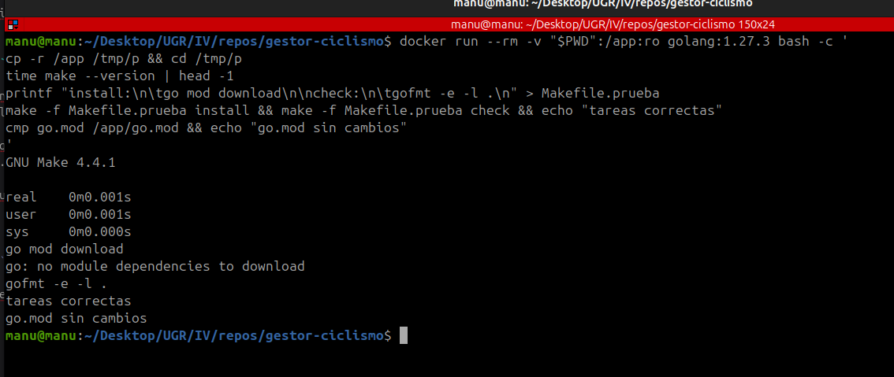
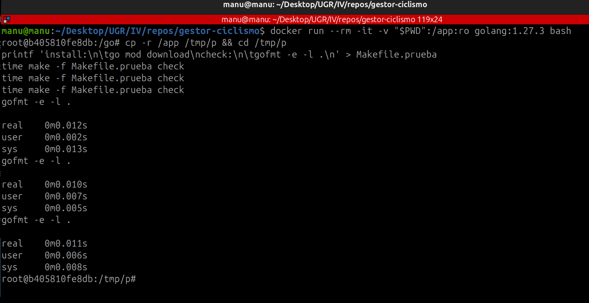

# Herramientas de automatización

## Gestor de dependencias

### Criterios

Para elegir sigo los criterios generales señalados en el guión, en el que se dice que "Si hay un estándar, primero hay que conocerlo; a continuación simplemente hay que seguirlo y adaptar el resto de los criterios al mismo". Los dos primeros son obligatorios, y entre las herramientas que los cumplan la elección la hacen los dos últimos.

1. **Estándar**: que sea el gestor de dependencias que define el propio Go en su documentación oficial (https://go.dev/ref/mod).
2. **Funciona con la versión del proyecto**: que se pueda usar con Go 1.27.3.
3. **Coste de instalación**: qué hay que instalar aparte de Go y cuánto tarda, medido en un contenedor limpio con la imagen oficial.
4. **Coste de ejecución**: cuánto tarda la orden que instala las dependencias del proyecto, medido en ese mismo contenedor.

### Herramientas consideradas

- **Módulos de Go** (https://go.dev/ref/mod):
  - Cumple los dos criterios obligatorios ya que es estandar y desde la version 1.16 de Go, este trabaja con los módulos por defecto, y por supuesto cumple el segundo criterio de funcionar con Go 1.27.3. Los siguientes dos criterios se medirán más adelante.

Al buscar gestores de dependencias para Go también aparecen estas herramientas, que se usaban antes de los módulos y siguen saliendo en tutoriales y proyectos antiguos. Ninguna cumple el primer criterio.

- [Modo GOPATH](https://pkg.go.dev/cmd/go): no es un gestor aparte, sino un modo de `go`. La documentación de `go` lo trata como un modo heredado, y desde Go 1.16 el modo por defecto son los módulos.
- [dep](https://github.com/golang/dep): no es el estándar. Está archivado y su README dice "As of 2020, Dep is deprecated and archived in favor of Go modules".
- [glide](https://github.com/Masterminds/glide): no es el estándar. Su README dice "The Go community is now using Go Modules to handle dependencies. Please consider using that instead of Glide."
- [govendor](https://github.com/kardianos/govendor): no es el estándar. Está archivado y su README dice "Use Go modules".
- [godep](https://github.com/tools/godep): no es el estándar. Está archivado y su README dice "Please use dep or another tool instead", y dep, a su vez, remite a los módulos de Go.

Por tanto, la única herramienta que cumple los dos criterios obligatorios y que pruebo es la de los módulos de Go.

### Prueba

Para medir el coste de instalación y el de ejecución he usado un contenedor Docker con la imagen oficial de Go, con la misma versión que fija `go.mod` (`golang:1.27.3`). Así parto de una máquina limpia que solo tiene Go.

- `go version`: muestra que Go 1.27.3 ya viene en la imagen, así que los módulos funcionan con la versión del proyecto y no hay que instalar nada aparte de Go. El coste de instalación es cero.
- `go list -m all`: lista todos los módulos que usa el proyecto. Solo aparece el propio, porque no hay ninguna dependencia externa.
- `go mod verify`: comprueba que los módulos descargados no se han modificado. Responde "all modules verified".

- `time go mod download`, tres veces, cada una en un contenedor nuevo, para medir el coste de ejecución: es la orden que instala las dependencias que declara `go.mod`. Las tres veces responde "no module dependencies to download" y tarda 0,008 s, 0,007 s y 0,007 s.

Ahora mismo instalar las dependencias no cuesta prácticamente nada porque el proyecto solo usa la biblioteca estándar. Este tiempo cambiará cuando se añada alguna dependencia a `go.mod`.

### Decisión final

Los módulos de Go son la única herramienta que cumple los dos criterios obligatorios: son el estándar de Go y funcionan con la versión del proyecto. Además, no hay que instalar nada aparte de Go y ahora mismo instalar las dependencias tarda unos 0,007 s. Por eso elijo los módulos de Go como gestor de dependencias.

## Gestor de tareas

### Criterios

Sigo los mismos criterios generales del guion que para el gestor de dependencias. Los dos primeros son obligatorios; entre las herramientas que los cumplan, deciden la deuda técnica y lo que cuesta tenerlas funcionando:

1. **Fichero de tareas**: que tenga un fichero donde estén escritas las tareas del proyecto y desde el que se puedan lanzar al menos `install` y `check`.
2. **Sin dependencias nuevas**: que no añada dependencias a `go.mod`, porque ahora no tiene ninguna y cada una que entra hay que mantenerla. Lo compruebo mirando si `go.mod` cambia después de usarla.
3. **Estándar**: el guion dice que "Si hay un estándar, primero hay que conocerlo; a continuación simplemente hay que seguirlo". El estándar de Go es `go`, así que es lo primero que compruebo. Si no cumple los criterios obligatorios, no hay un estándar que seguir y deciden los criterios 4 y 5.
4. **Deuda técnica**: según el guion, "si elegimos una herramienta que no se mantiene con asiduidad estaremos aumentando la deuda técnica", porque más adelante habría que cambiarla. Lo compruebo mirando si su repositorio ha tenido algún commit en el último año.
5. **Coste de instalación y de ejecución**: qué hay que instalar aparte de Go, cuánto tarda y cuánto tarda después en lanzar `check`.

### Opciones

Para buscar las opciones he buscado en "Build Automation" dentro del repo awesome-go (https://github.com/avelino/awesome-go#build-automation), que es la lista que mantiene la comunidad de Go con las herramientas de cada categoría, y he mirado el repositorio de cada una de las que aparecen. A esas les he sumado just (https://github.com/casey/just), que no aparece en la lista porque no está escrita en Go, pero sirve para cualquier lenguaje, y make.

El estándar del propio lenguaje es `go`. En el link que se deja en el guión (https://jj.github.io/curso-tdd/temas/gestores-tareas.html) se explica que "Go es un ejemplo de lenguaje que usa task runner implícito: como subcomandos de go se compila, se pasan tests o se instala un paquete". Por el criterio del estándar, es lo primero que compruebo: si con `go` bastara, no haría falta añadir nada al proyecto.

Antes de hacer pruebas, descarto las opciones que no cumplen algún criterio de los antes definidos:

- air (https://github.com/air-verse/air), anko (https://github.com/GuilhermeCaruso/anko), gaper (https://github.com/maxcnunes/gaper) y realize (https://github.com/oxequa/realize) no cumplen el criterio 1. Según la descripción de sus repositorios, vigilan los ficheros y vuelven a compilar o reiniciar la aplicación cuando cambian por lo que sirven para recargar la aplicación mientras se desarrolla, no para escribir tareas como `install` o `check` en un fichero y lanzarlas.
- gob (https://github.com/kcmvp/gob), que es el repositorio que aparece en awesome-go, ya no existe, así que no se puede usar.
- mmake (https://github.com/tj/mmake) y gilbert (https://github.com/go-gilbert/gilbert) no cumplen el criterio 4: mmake no tiene ningún commit desde marzo de 2020, y gilbert no tiene ninguno desde enero de 2025. Si eligiera cualquiera de las dos, generaria deuda técnica.

Pruebo el resto que si cumplen los criterios a priori: make, Task, just, Mage, 1build, taskctl, xc, goyek y rex. Antes de eso, compruebo si con `go` solo es suficiente.

### `go` solo

Para comprobar si `go`, el estándar del lenguaje, cumple el criterio 1, he ejecutado `go help` en un contenedor con la imagen oficial de Go, que muestra todos los subcomandos de `go`. Al revisarlos no he encontrado ninguno que lea un fichero de tareas: `go` solo ejecuta las tareas que trae de fábrica, como `build`, `test` o `vet`, y no se pueden añadir tareas propias con el nombre que yo quiera.

Por si acaso, he intentado ejecutar también `go check`, y me da el error "go check: unknown command" por lo que tampoco existe la tarea `check` que necesito.

Como `go` no tiene un fichero donde estén escritas las tareas del proyecto ni permite lanzar `check`, no cumple el criterio 1 y queda descartado.

### Qué hace la tarea `check`

Antes de probar las herramientas he decidido qué orden va a lanzar la tarea `check`, porque va a ser la misma en todas las pruebas. Esta tarea tiene que comprobar que la sintaxis de los fuentes es correcta y solo eso, así que no me sirve `go build`, que es lo que tenía antes: compila el código y tiene efectos secundarios, porque genera resultados de la compilación.

He elegido `gofmt -e -l .`, que según su documentación (https://pkg.go.dev/cmd/gofmt) solo analiza la sintaxis de los ficheros `.go`: con `-e` muestra todos los errores de sintaxis y con `-l` solo imprime el nombre de los ficheros, sin modificar nada.

Para comprobar que hace lo que necesito, he entrado en un contenedor limpio con la imagen oficial de Go (`golang:1.27.3`) y he creado a mano tres ficheros de prueba, lanzando cada vez `gofmt -e -l .` y mirando después el código de salida con `echo $?`, que es 0 si la orden ha ido bien y otro número si ha fallado.

Primero he creado un fichero correcto, con una función que suma dos números, y `gofmt` no ha mostrado nada y ha terminado con código 0.

Después he añadido otro fichero con un error de sintaxis, una función a la que le falta la llave de cierre, y esta vez `gofmt` ha mostrado el error indicando el fichero y la línea, y ha terminado con código 2, por lo que la tarea `check` fallaría, que es lo que quiero cuando hay un error.

Por último he borrado ese fichero y he creado otro con un error de tipos, una función que tiene que devolver un número pero devuelve un texto. En este caso `gofmt` no ha dicho nada y ha terminado con código 0, porque la sintaxis es correcta y el error es de tipos, lo que confirma que solo comprueba la sintaxis.

### Pruebas

Todas las pruebas las hago igual: en un contenedor limpio con la imagen oficial de Go (`golang:1.27.3`) copio el repositorio, instalo la herramienta midiendo con `time` lo que tarda, creo su fichero de tareas con `install` (`go mod download`) y `check` (`gofmt -e -l .`), lanzo las dos tareas y compruebo con `cmp` que `go.mod` no ha cambiado.

Para instalar cada herramienta uso el método que recomienda su documentación oficial para una máquina nueva, y en cada prueba indico dónde lo he encontrado. Algunas se pueden instalar de varias formas, por ejemplo descargando el programa ya compilado o compilándolo con `go install`, y cada forma tarda un tiempo muy distinto, así que si usara métodos diferentes según me conviniera la comparación no sería justa.

Para preparar las pruebas me he ayudado IA generativa, que me ha ayudado a generar el fichero de tareas de cada herramienta y algunas de las órdenes para instalarlas dentro del contenedor. En las pruebas de instalación he lanzado todas las órdenes de una vez, dentro de un único `docker run`, para que en la captura se vea completo lo que he hecho: la orden con la que instalo la herramienta, el fichero de tareas que creo, las tareas que lanzo y la comprobación de `go.mod`, junto con su resultado.

Además de la instalación, mido lo que tarda cada herramienta en ejecutar la tarea `check`, porque en Docker y en la integración continua no solo se instala la herramienta, sino que también se lanzan las tareas cada vez. Para cada herramienta abro otro contenedor limpio, la instalo, creo su fichero de tareas y lanzo `time` con la tarea `check` tres veces seguidas. La primera es la que cuenta en una máquina limpia, y las otras dos sirven para ver si el tiempo se repite.

Antes de eso he medido lo mismo sin ninguna herramienta, lanzando `gofmt -e -l .` directamente, para tener un tiempo base con el que comparar: lo que tarde cada herramienta por encima de ese tiempo es lo que añade ella. Las tres ejecuciones han tardado 0,019 s, 0,006 s y 0,009 s.

#### make

make ya viene instalado en la imagen oficial de Go, así que no hay que instalar nada aparte. He creado un Makefile con las tareas `install` y `check`, las dos se han ejecutado correctamente desde el fichero y `go.mod` no ha cambiado, por lo que make cumple los dos primeros criterios y no cuesta nada tenerlo funcionando. 

Para medir la ejecución he lanzado `make -f Makefile.prueba check` tres veces en otro contenedor limpio, y ha tardado 0,012 s, 0,010 s y 0,011 s, prácticamente lo mismo que lanzar `gofmt` directamente, así que make no añade casi nada al ejecutar la tarea.

