# Herramientas de automatización

## Gestor de dependencias

### Criterios

Para elegir sigo los criterios generales señalados en el guión, en el que se dice que "Si hay un estándar, primero hay que conocerlo; a continuación simplemente hay que seguirlo y adaptar el resto de los criterios al mismo". Los dos primeros son obligatorios, y entre las herramientas que los cumplan la elección la hacen los dos últimos.

1. **Estándar**: que sea el gestor de dependencias que define el propio Go en su documentación oficial (https://go.dev/ref/mod).
2. **Funciona con la versión del proyecto**: que se pueda usar con Go 1.27.3.
3. **Coste de instalación**: qué hay que instalar aparte de Go y cuánto tarda, medido en un contenedor limpio con la imagen oficial.
4. **Coste de ejecución**: cuánto tarda la orden que instala las dependencias del proyecto, medido en ese mismo contenedor.

### Herramientas consideradas

- **Módulos de Go** (https://go.dev/ref/mod):
  - Cumple los dos criterios obligatorios ya que es estandar y desde la version 1.16 de Go, este trabaja con los módulos por defecto, y por supuesto cumple el segundo criterio de funcionar con Go 1.27.3. Los siguientes dos criterios se medirán más adelante.

Al buscar gestores de dependencias para Go también aparecen estas herramientas, que se usaban antes de los módulos y siguen saliendo en tutoriales y proyectos antiguos. Ninguna cumple el primer criterio.

- [Modo GOPATH](https://pkg.go.dev/cmd/go): no es un gestor aparte, sino un modo de `go`. La documentación de `go` lo trata como un modo heredado, y desde Go 1.16 el modo por defecto son los módulos.
- [dep](https://github.com/golang/dep): no es el estándar. Está archivado y su README dice "As of 2020, Dep is deprecated and archived in favor of Go modules".
- [glide](https://github.com/Masterminds/glide): no es el estándar. Su README dice "The Go community is now using Go Modules to handle dependencies. Please consider using that instead of Glide."
- [govendor](https://github.com/kardianos/govendor): no es el estándar. Está archivado y su README dice "Use Go modules".
- [godep](https://github.com/tools/godep): no es el estándar. Está archivado y su README dice "Please use dep or another tool instead", y dep, a su vez, remite a los módulos de Go.

Por tanto, la única herramienta que cumple los dos criterios obligatorios y que pruebo es la de los módulos de Go.

### Prueba

Para medir el coste de instalación y el de ejecución he usado un contenedor Docker con la imagen oficial de Go, con la misma versión que fija `go.mod` (`golang:1.27.3`). Así parto de una máquina limpia que solo tiene Go.

- `go version`: muestra que Go 1.27.3 ya viene en la imagen, así que los módulos funcionan con la versión del proyecto y no hay que instalar nada aparte de Go. El coste de instalación es cero.
- `go list -m all`: lista todos los módulos que usa el proyecto. Solo aparece el propio, porque no hay ninguna dependencia externa.
- `go mod verify`: comprueba que los módulos descargados no se han modificado. Responde "all modules verified".

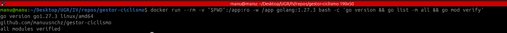

- `time go mod download`, tres veces, cada una en un contenedor nuevo: es la orden que instala las dependencias que declara `go.mod`. Las tres veces responde "no module dependencies to download" y tarda 0,008 s, 0,007 s y 0,007 s, porque no tiene nada que descargar.

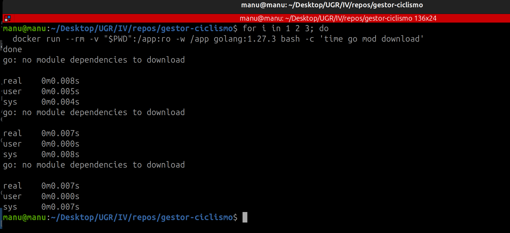

Por tanto, esta medida no sirve todavía para saber cuánto cuesta instalar dependencias con los módulos de Go: el proyecto solo usa la biblioteca estándar y la orden no tiene nada que descargar.

### Decisión final

Los módulos de Go son la única herramienta que cumple los dos criterios obligatorios: son el estándar de Go y funcionan con la versión del proyecto. Además, no hay que instalar nada aparte de Go y, por ahora, el proyecto no tiene dependencias que descargar. Por eso elijo los módulos de Go como gestor de dependencias.

## Gestor de tareas

### Criterios

1. **Tiempo de instalación**: qué hay que instalar aparte de Go y cuánto tarda.
2. **Tiempo de ejecución**: cuánto tarda en lanzar la tarea `check`.

### Opciones

He buscado las opciones en "Build Automation" dentro del repo awesome-go (https://github.com/avelino/awesome-go#build-automation). Como en esa sección no todo lo que hay son gestores de tareas me he quedado solo con las que sirven para escribir tareas en un fichero y lanzarlas. A esas les he sumado just (https://github.com/casey/just), que no aparece en la lista porque no está escrita en Go, pero sirve para cualquier lenguaje, y make.

De esa sección quedan fuera air, anko, gaper y realize, que sirven para recargar la aplicación mientras se desarrolla, y gob, cuyo repositorio ya no existe. mmake no lo pruebo porque, según su README, funciona por encima de make, así que no es una alternativa a make.

Pruebo make, Task, just, Mage, 1build, taskctl, xc, goyek, rex y gilbert.

### Pruebas

#### make

make no hay que instalarlo, ya que lo tengo instalado (GNU Make 4.4.1). `make check` ha tardado 0,036 s, 0,014 s y 0,015 s.

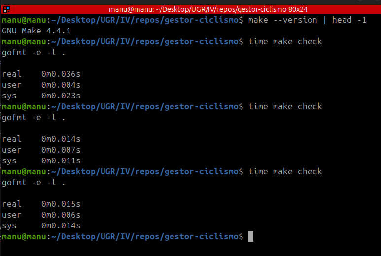

#### Task

Task (https://github.com/go-task/task) no viene en la imagen, así que hay que instalarlo aparte. He usado el script de instalación que da su documentación oficial (https://taskfile.dev/installation/), que busca la última versión en GitHub. La instalación ha tardado 3,874 s y ha instalado la versión 3.54.0. He creado un `Taskfile.yml` con las tareas `install` y `check`, las dos se han ejecutado correctamente desde el fichero y `go.mod` no ha cambiado, por lo que Task también cumple los dos primeros criterios, pero necesita descargar el programa cada vez que se parte de una máquina limpia.

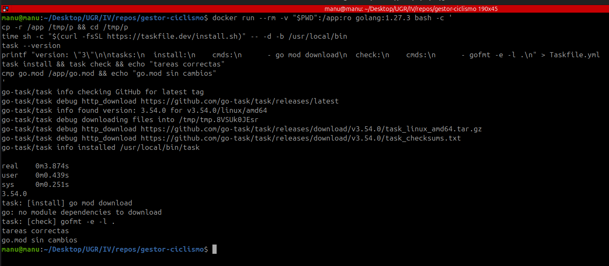

Para medir la ejecución he lanzado `task check` tres veces en otro contenedor limpio, y ha tardado 0,102 s, 0,088 s y 0,088 s, así que Task sí añade algo de tiempo cada vez que se ejecuta una tarea.

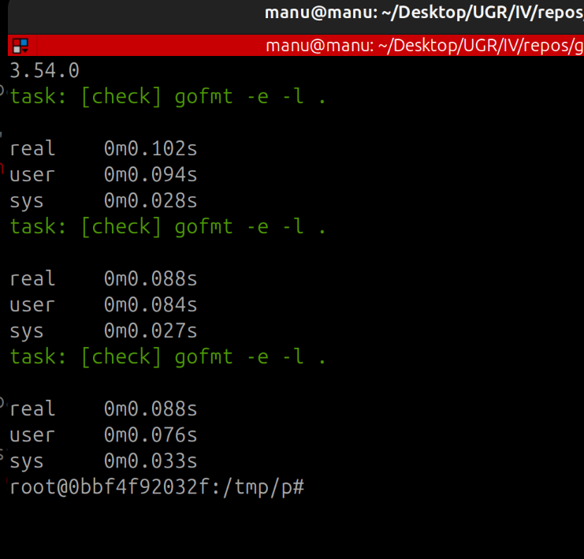

#### just

just (https://github.com/casey/just) tampoco viene en la imagen. Para instalarlo he usado el script que da su README oficial en el apartado "Pre-built Binaries", que, igual que el de Task, descarga el programa ya compilado desde GitHub. La instalación ha tardado 1,471 s y ha instalado la versión 1.59.0. He creado un `justfile` con las tareas `install` y `check`, las dos se han ejecutado correctamente desde el fichero y `go.mod` no ha cambiado, por lo que just también cumple los dos primeros criterios, pero, como Task, necesita descargar el programa cada vez que se parte de una máquina limpia.

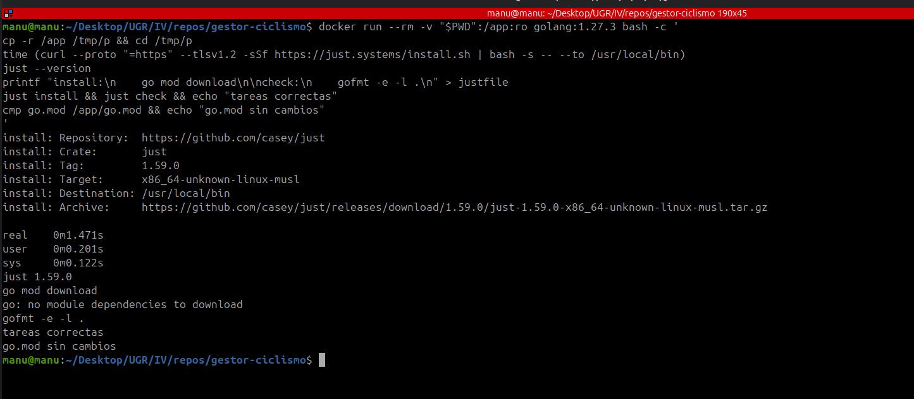

Para medir la ejecución he lanzado `just check` tres veces en otro contenedor limpio, y ha tardado 0,027 s, 0,016 s y 0,013 s, solo unos milisegundos más que lanzar `gofmt` directamente.

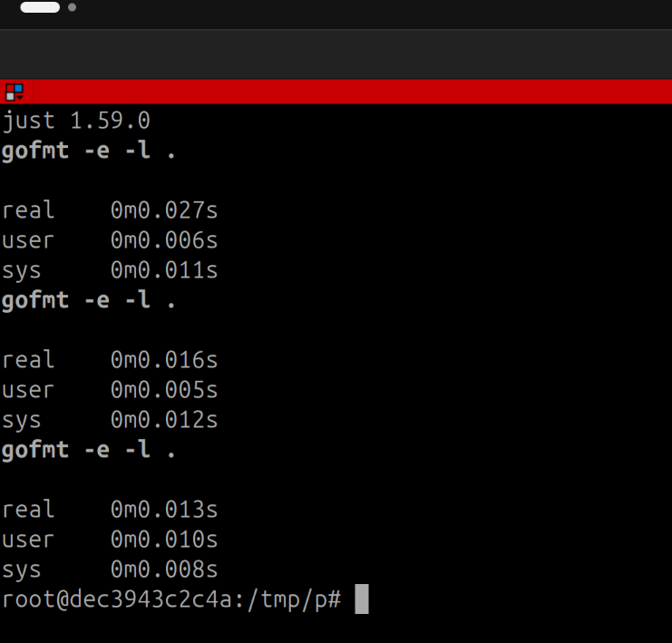

#### Mage

Mage (https://github.com/magefile/mage) es distinto a los anteriores, porque las tareas se escriben en Go, en un fichero `magefile.go` donde cada función es una tarea. Tampoco viene en la imagen, así que lo he instalado con `go install github.com/magefile/mage@latest`, que descarga el código fuente y lo compila. La instalación ha tardado 5,032 s y ha instalado la versión 1.17.2.

En el `magefile.go` solo he usado la biblioteca estándar de Go para lanzar las órdenes, y no las funciones de ayuda de Mage, porque esas habría que importarlas y añadirían una dependencia a `go.mod`. Así, las dos tareas se han ejecutado correctamente y `go.mod` no ha cambiado, por lo que Mage cumple los dos primeros criterios, pero es la que más cuesta tener funcionando de las que llevo probadas.

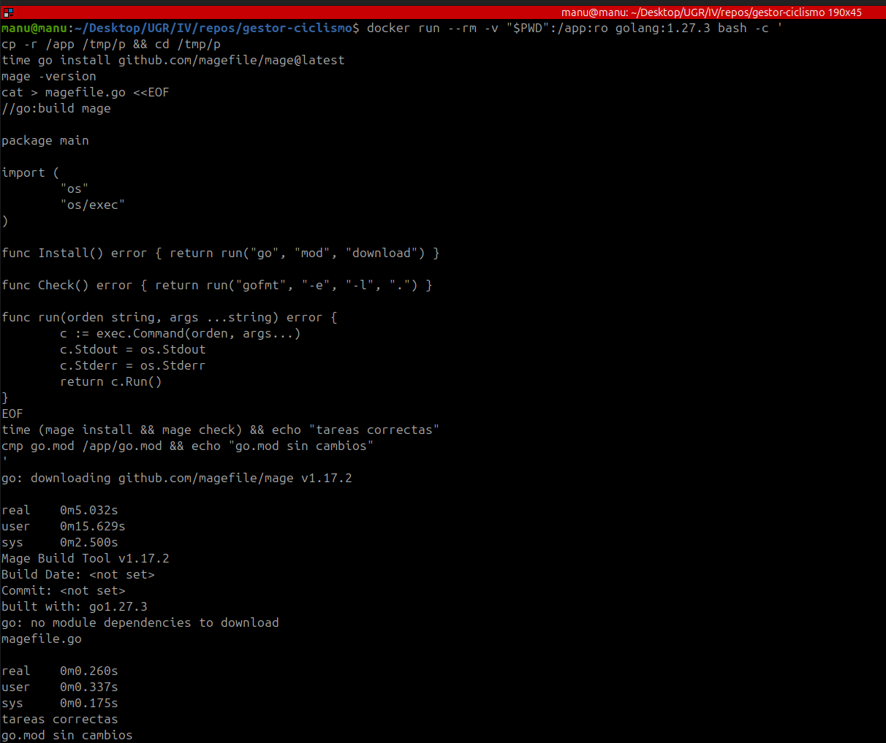

Para medir la ejecución he lanzado `mage check` tres veces en otro contenedor limpio, y ha tardado 0,377 s, 0,097 s y 0,097 s. La primera vez es mucho más lenta porque Mage compila antes el `magefile.go`. Las otras dos siguen tardando unos 90 ms más que lanzar `gofmt` directamente.

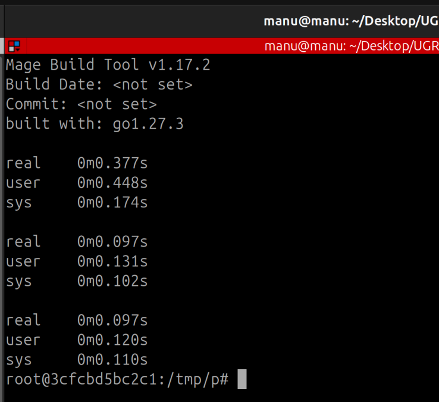

#### 1build

1build (https://github.com/gopinath-langote/1build) tampoco viene en la imagen. He descargado el programa ya compilado desde su última versión publicada. La descarga y la instalación han tardado 1,026 s y han instalado la versión 1.10.4. He creado un `1build.yaml` con el nombre del proyecto y las órdenes `install` y `check`, las dos se han ejecutado correctamente desde el fichero y `go.mod` no ha cambiado, por lo que 1build también cumple los dos primeros criterios, pero necesita descargar el programa cada vez que se parte de una máquina limpia.

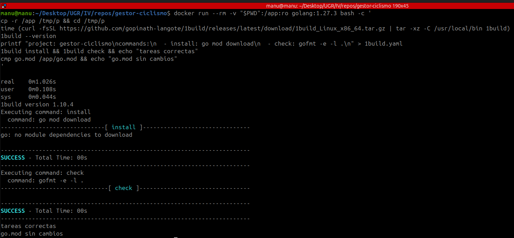

Para medir la ejecución he lanzado `1build check` tres veces en otro contenedor limpio, y ha tardado 0,013 s, 0,011 s y 0,011 s, prácticamente lo mismo que lanzar `gofmt` directamente.

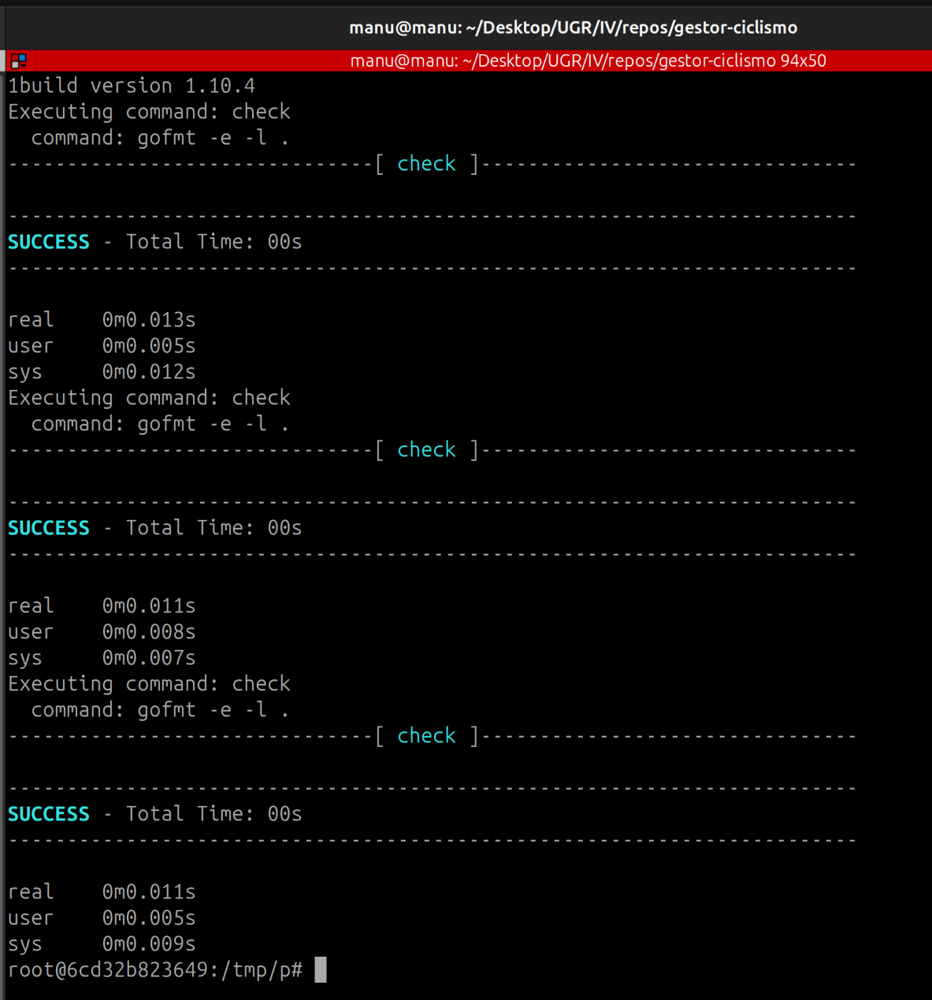

#### taskctl

taskctl (https://github.com/taskctl/taskctl) tampoco viene en la imagen. Para Linux, su README oficial dice que se instala descargando el fichero `taskctl_linux_amd64` desde su última versión publicada. Al hacerlo, GitHub redirige a la versión 1.4.2, que es de abril de 2021 y sigue siendo la última versión estable, y la descarga falla con un error 404 porque ese fichero no existe en esa versión. Como consecuencia, `taskctl` no llega a instalarse, por lo que como no puedo probarlo, queda descartado.

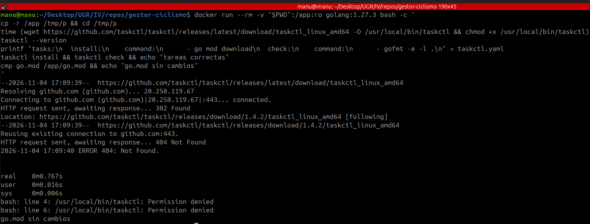

#### xc

xc (https://github.com/joerdav/xc) tampoco viene en la imagen. La forma de instalarlo que da su guía oficial (https://xcfile.dev/getting-started/#installation) es descargar el programa ya compilado desde sus versiones publicadas en GitHub. La descarga ha tardado 0,584 s y ha instalado la versión 0.9.0. Lo distinto de xc es que las tareas se escriben en un fichero Markdown, bajo un título `## Tasks`, con cada tarea como un subtítulo y su orden en un bloque de código. Por defecto las busca en el `README.md`, pero para la prueba he usado un fichero aparte, `tareas.md`. Las dos tareas se han ejecutado correctamente desde el fichero y `go.mod` no ha cambiado, por lo que xc también cumple los dos primeros criterios, pero necesita descargar el programa cada vez que se parte de una máquina limpia.

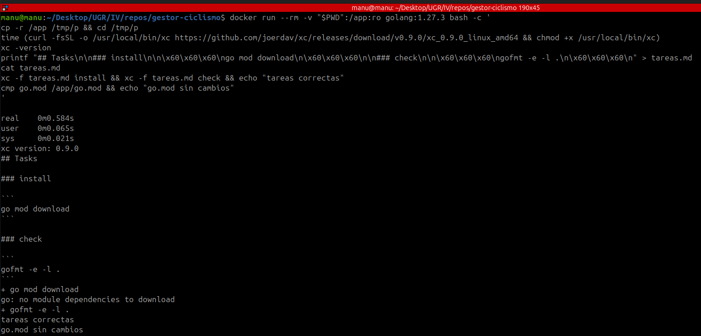

Para medir la ejecución he lanzado `xc -f tareas.md check` tres veces en otro contenedor limpio, y ha tardado 0,016 s, 0,010 s y 0,009 s, prácticamente lo mismo que lanzar `gofmt` directamente.

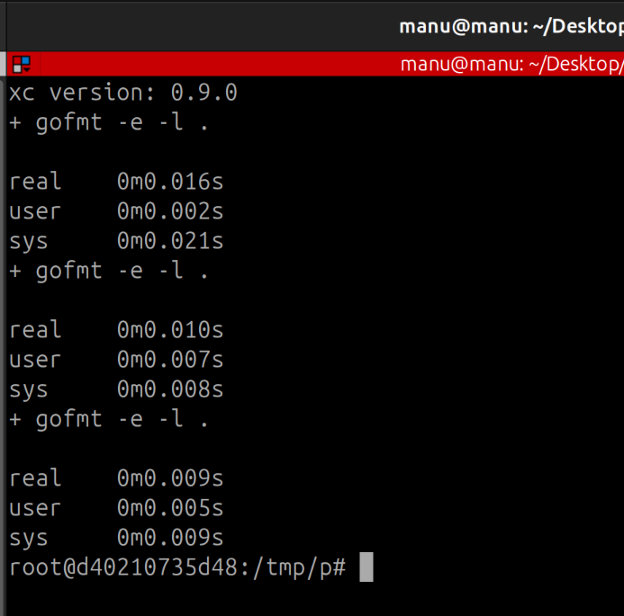

#### goyek

goyek (https://github.com/goyek/goyek) no es un programa que se instale, sino una biblioteca de Go: las tareas se escriben en Go en una carpeta `build/` que importa goyek, y se lanzan con `go run`. He seguido los pasos de su README: he creado `build/main.go` con las tareas `install` y `check` y he ejecutado `go mod tidy`, que es lo que hace de instalación y ha tardado 2,794 s. Las dos tareas se han ejecutado correctamente, pero `go mod tidy` ha añadido a `go.mod` dos dependencias directas, `github.com/goyek/goyek/v3` y `github.com/goyek/x`, y otras indirectas que estas necesitan. Como no cumple el segundo criterio, goyek queda descartado.

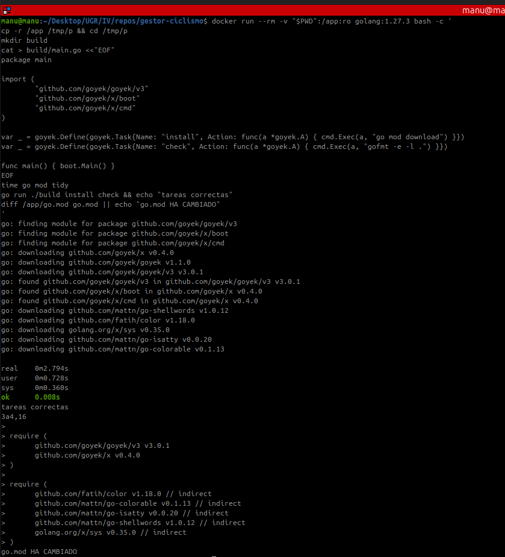

#### rex

rex (https://github.com/rexrun-dev/rex) no viene en la imagen. Lo he instalado con `go install` , igual que con Mage, que ha tardado 8,375 s en descargarlo y compilarlo, y ha instalado la versión 0.5.0. Las tareas se escriben en un fichero `rex.toml`, en la sección `[commands]`. Según su README, si el proyecto ya tiene un Makefile, rex lo usa antes que su propio fichero, así que en la copia del contenedor he borrado el Makefile para probar de verdad rex y no make. Las dos tareas se han ejecutado correctamente desde `rex.toml` y `go.mod` no ha cambiado, por lo que rex cumple los dos primeros criterios, pero es la herramienta que más ha tardado en instalarse de todas las que he probado.

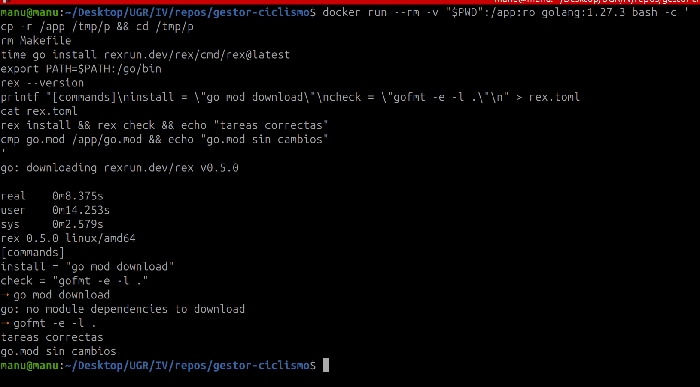

Para medir la ejecución he lanzado `rex check` tres veces en otro contenedor limpio, también sin el Makefile, y ha tardado 0,011 s, 0,009 s y 0,007 s, prácticamente lo mismo que lanzar `gofmt` directamente.

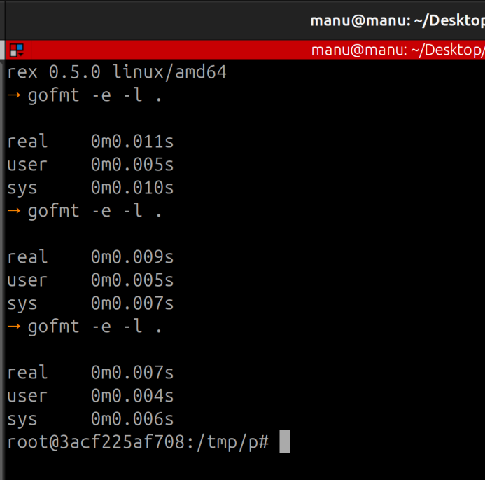

### Decisión final

Después de las pruebas , descarto `go` porque no cumple el criterio 1, taskctl porque no se puede instalar con el método de su documentación, y goyek porque añade dependencias a `go.mod` (criterio 2). make, Task, just, Mage, 1build, xc y rex cumplen los dos criterios obligatorios y todas tienen commits en el último año, así que tampoco las separa la deuda técnica (criterio 4). Lo que decide es el criterio 5: make ya viene en la imagen oficial de Go, así que no hay que instalar nada aparte, mientras que las demás tardan en instalarse entre los 0,584 s de xc y los 8,375 s de rex. Al lanzar `check`, make tarda lo mismo que `gofmt` directamente, mientras que Task tarda unos 80 ms más cada vez y Mage unos 370 ms más la primera vez, porque tiene que compilar el `magefile.go`. Por eso elijo make, con un Makefile en la raíz del repositorio con las tareas `install` y `check`.
