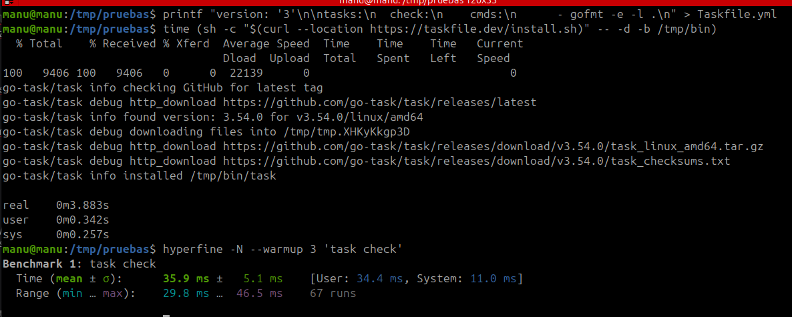
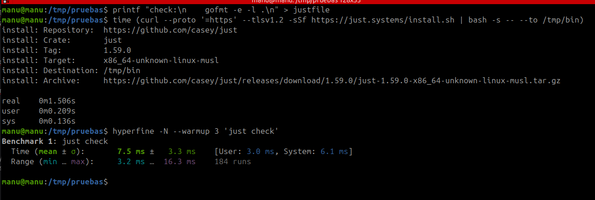
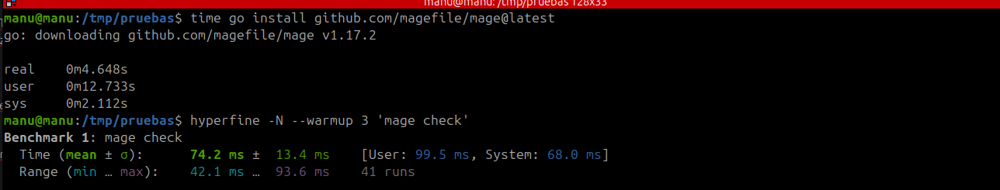
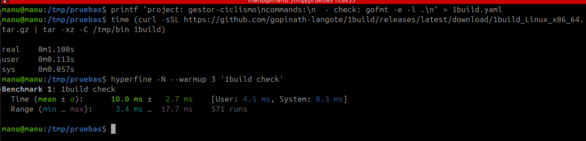
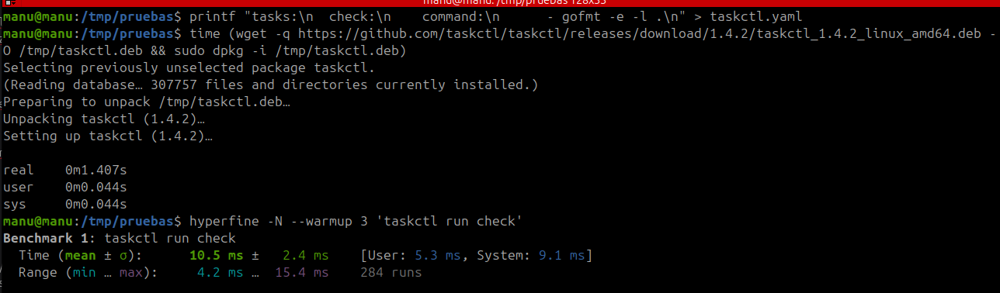
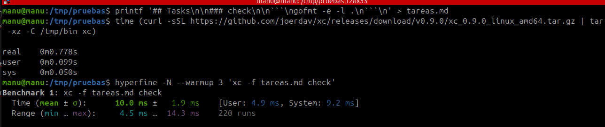
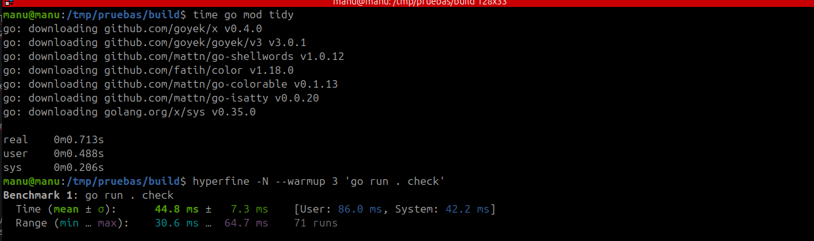
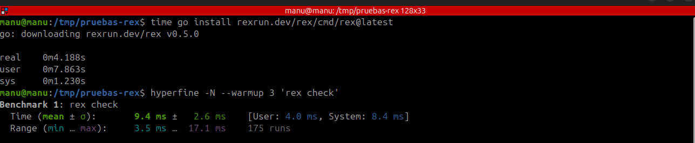
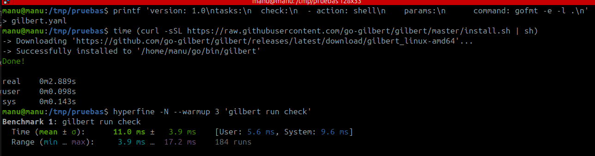

# Herramientas de automatización

## Gestor de dependencias

Solo hay una opción, los módulos de Go (https://go.dev/ref/mod), ya que es el estándar y desde la versión 1.16 de Go (https://go.dev/doc/go1.16#modules) este trabaja con los módulos por defecto. No hay que instalar nada aparte de Go.

## Gestor de tareas

### Criterios

1. **Tiempo de instalación**: qué hay que instalar aparte de Go y cuánto tarda en instalarse.
2. **Tiempo de ejecución**: cuánto tarda de media en lanzar la tarea `check`, haciendo un uso normal y no la primera vez.

### Opciones

He buscado las opciones en "Build Automation" dentro del repo awesome-go (https://github.com/avelino/awesome-go#build-automation). Como en esa sección no todo lo que hay son gestores de tareas me he quedado solo con las que sirven para escribir tareas en un fichero y lanzarlas. A esas les he sumado just (https://github.com/casey/just), que no aparece en la lista porque no está escrita en Go, pero sirve para cualquier lenguaje, y make.

De esa sección quedan fuera air, anko, gaper y realize, que sirven para recargar la aplicación mientras se desarrolla, y gob, cuyo repositorio ya no existe. mmake no lo pruebo porque, según su README, funciona por encima de make, así que no es una alternativa a make.

Pruebo make, Task, just, Mage, 1build, taskctl, xc, goyek, rex y gilbert.

### Pruebas

Mido el tiempo de `check` con hyperfine (https://github.com/sharkdp/hyperfine) con la orden: `hyperfine -N --warmup 3 '<orden>'`, siendo `<orden>` el comando usado para cada herramienta. hyperfine me dio un aviso de que las medidas de los comandos que tardan menos de 5 ms pueden no ser exactas. Si no uso `-N`, estoy midiendo en gran parte el arranque del shell por lo que no sería realista. También uso `--warmup` para medir el uso normal de `check`, y no la primera ejecución en frío. Uso la media ± σ.

#### make

make no hay que instalarlo, ya que lo tengo instalado. `make check` ha tardado de media 7,1 ms ± 2,2 ms.

#### Task

Task (https://github.com/go-task/task) hay que instalarlo. Con el script de su documentación oficial (https://taskfile.dev/installation/), la instalación ha tardado 3,883 s. `task check` ha tardado de media 35,9 ms ± 5,1 ms.

#### just

just (https://github.com/casey/just) hay que instalarlo. Con el script del apartado "Pre-built Binaries" de su README, la instalación ha tardado 1,506 s. `just check` ha tardado de media 7,5 ms ± 3,3 ms.

#### Mage

Mage (https://github.com/magefile/mage) hay que instalarlo. Las tareas se escriben como funciones de Go en un fichero `magefile.go`. Con `go install`, la instalación ha tardado 4,648 s. `mage check` ha tardado de media 74,2 ms ± 13,4 ms.

#### 1build

1build (https://github.com/gopinath-langote/1build) hay que instalarlo. Descargando el programa ya compilado de su última versión publicada, como indica su README, la instalación ha tardado 1,100 s. `1build check` ha tardado de media 10,0 ms ± 2,7 ms.

#### taskctl

taskctl (https://github.com/taskctl/taskctl) hay que instalarlo. El método para Linux de su README da un error 404, porque el fichero que indica no existe en su última versión, así que lo he instalado con el paquete `.deb`, que es la otra forma que da el README. La instalación ha tardado 1,407 s. `taskctl run check` ha tardado de media 10,5 ms ± 2,4 ms.

#### xc

xc (https://github.com/joerdav/xc) hay que instalarlo. Las tareas se escriben en un fichero Markdown, bajo un título `## Tasks`. Descargando el programa ya compilado, como indica su guía oficial (https://xcfile.dev/getting-started/#installation), la instalación ha tardado 0,778 s. `xc -f tareas.md check` ha tardado de media 10,0 ms ± 1,9 ms.

#### goyek

goyek (https://github.com/goyek/goyek) no es un programa, sino una biblioteca de Go: las tareas se escriben en Go en una carpeta `build/` y se lanzan con `go run`. Siguiendo su README, la instalación es `go mod tidy`, que ha tardado 0,713 s. `go run . check` ha tardado de media 44,8 ms ± 7,3 ms.

#### rex

rex (https://github.com/rexrun-dev/rex) hay que instalarlo. Las tareas se escriben en un fichero `rex.toml`, en la sección `[commands]`; según su README, si hay un Makefile lo usa antes, así que lo he probado en una copia del repositorio sin él. Con `go install`, como indica su README, la instalación ha tardado 4,188 s. `rex check` ha tardado de media 9,4 ms ± 2,6 ms.

#### gilbert

gilbert (https://github.com/go-gilbert/gilbert) hay que instalarlo. Las tareas se escriben en un fichero `gilbert.yaml` y se lanzan con `gilbert run`. Con el script de su guía oficial (https://go-gilbert.github.io/docs/quick-start/), la instalación ha tardado 2,889 s. `gilbert run check` ha tardado de media 11,0 ms ± 3,9 ms.

### Decisión final

make es la única que no hay que instalar, y las demás tardan en instalarse entre los 0,713 s de goyek y los 4,648 s de Mage. Al lanzar `check`, make tarda lo mismo que las más rápidas, 7,1 ms frente a los 7,5 ms de just, mientras que Task tarda 35,9 ms, y Mage y goyek tardan más porque compilan sus tareas antes de lanzarlas. Por eso elijo make.
