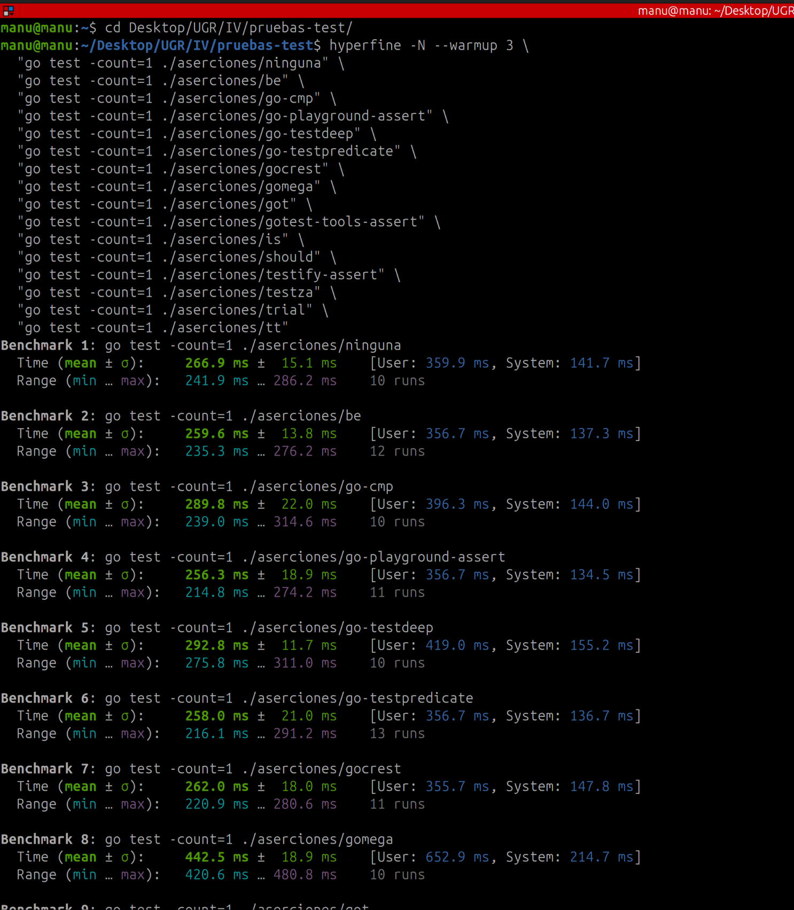
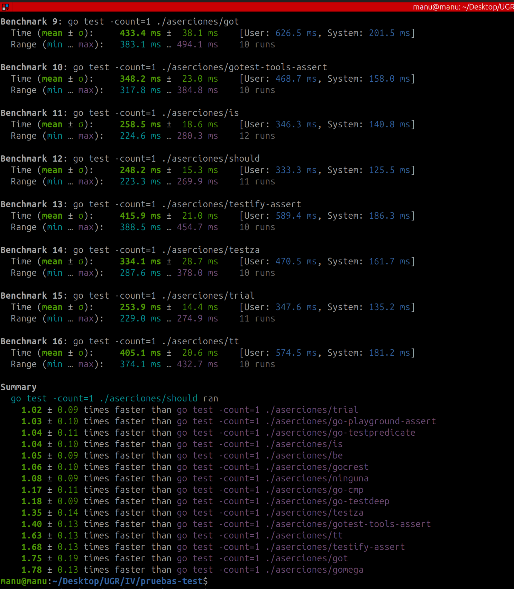
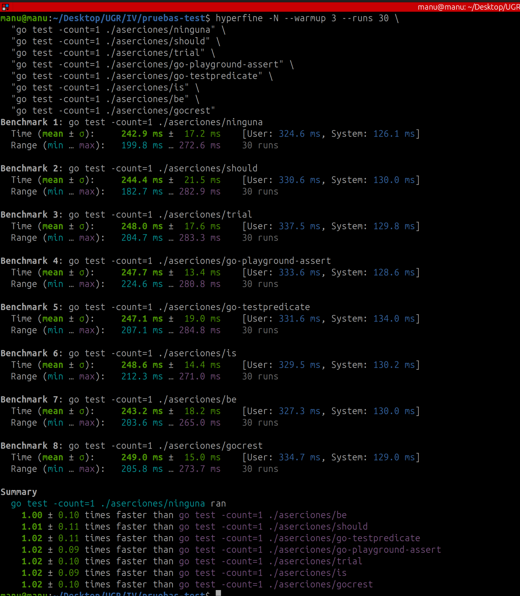
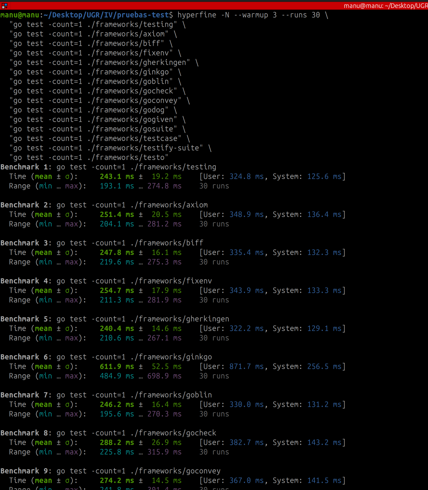
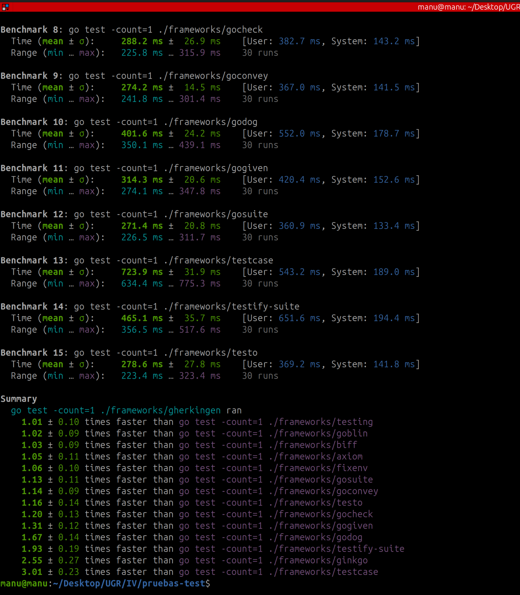
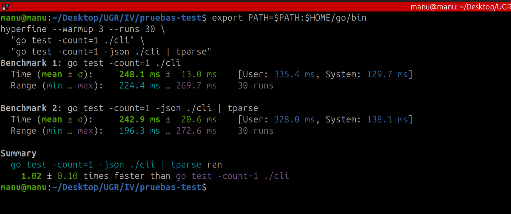

# Herramientas de test

## Biblioteca de aserciones

### Criterios

1. **No escribir en el directorio del código**: al ejecutar los tests que la usan no puede crear ni modificar ficheros dentro del repositorio, o tiene que dejar configurar dónde lo hace, porque más adelante los tests se ejecutarán en un contenedor en el que no se puede escribir ahí. La que no lo cumpla queda fuera.
2. **Tiempo de ejecución**: cuánto tarda de media en ejecutarse el mismo test escrito con cada una, medido con hyperfine.

### Opciones

He buscado las opciones en la sección "Testing Frameworks" del repo awesome-go (https://github.com/avelino/awesome-go#testing-frameworks). Como ahí están mezclados los tres niveles con herramientas para otros tipos de test, me he quedado solo con las que sirven para comprobar el resultado de un test unitario. Además, considero no usar ninguna biblioteca, ya que el paquete `testing` permite comprobar los resultados sin ella. Las opciones son:

- Ninguna biblioteca: comprobar con un `if` y marcar el fallo con `t.Errorf` del paquete `testing`, que es lo que recomienda la wiki de Go (https://go.dev/wiki/TestComments).
- go-cmp (https://github.com/google/go-cmp): lo mantiene el equipo de Go. Solo compara dos valores y devuelve la diferencia; el fallo se marca igualmente con `t.Errorf`.
- Bibliotecas con funciones de aserción: assert (https://github.com/go-playground/assert), be (https://github.com/earthboundkid/be), go-testdeep (https://github.com/maxatome/go-testdeep), is (https://github.com/matryer/is), should (https://github.com/Kairum-Labs/should), trial (https://github.com/jgroeneveld/trial), Tt (https://github.com/vcaesar/tt), testza (https://github.com/MarvinJWendt/testza), got (https://github.com/ysmood/got) y los paquetes `assert` de Testify (https://github.com/stretchr/testify) y de gotest.tools (https://github.com/gotestyourself/gotest.tools). testza y got se presentan como frameworks, pero lo que añaden a `testing` son aserciones.
- Bibliotecas de matchers o de estilo BDD, que se leen más como una frase: gomega (https://github.com/onsi/gomega), gocrest (https://github.com/corbym/gocrest), Hamcrest (https://github.com/rdrdr/hamcrest) y go-testpredicate (https://github.com/maargenton/go-testpredicate).

### Pruebas

Escribo el mismo test, que comprueba una suma, con cada opción en un módulo aparte del repositorio. Hamcrest no lo pruebo porque es de antes de Go 1 y no compila con las versiones de ahora.

Para el primer criterio ejecuto los tests de cada opción sin permisos de escritura en el módulo (`chmod -R a-w`). Pasan todas, así que ninguna escribe en el directorio del código.

Para el segundo mido `go test -count=1` de cada opción con `hyperfine -N --warmup 3`. Pongo `-count=1` para que Go no tire de la caché y ejecute el test cada vez. Uso la media ± σ.

Las más lentas son tt, Testify, got y gomega, que tardan entre 405 ms y 443 ms. No usar ninguna biblioteca, should, trial, assert de go-playground, go-testpredicate, is, be y gocrest tardan entre 248 ms y 267 ms, pero cada una tiene una σ de entre 14 ms y 21 ms, así que no se puede decir cuál es la más rápida. Vuelvo a medir esas 8 con `--runs 30` y quedan todas entre 242,9 ms y 249,0 ms.

### Decisión final

Todas cumplen el primer criterio. En el segundo, no usar ninguna biblioteca tarda lo mismo que las más rápidas, así que añadir una no aporta nada. Por eso no uso biblioteca de aserciones.

## Test runner o framework

### Criterios

1. **No escribir en el directorio del código**: igual que en las aserciones, al ejecutar los tests no puede crear ni modificar ficheros dentro del repositorio, o tiene que dejar configurar dónde lo hace. El que no lo cumpla queda fuera.
2. **Tiempo de ejecución**: cuánto tarda de media en ejecutarse el mismo test escrito con cada uno, medido con hyperfine.

### Opciones

He buscado en la misma sección de awesome-go las que sirven para agrupar los tests en subtests, para escribirlos en estilo BDD o para crear fixtures y funciones que se ejecutan antes o después de cada test o de todos los tests. Además, considero el paquete `testing` de Go, que ya permite agrupar los tests en subtests. Las opciones son:

- El paquete `testing` (https://pkg.go.dev/testing), que viene con Go.
- De estilo BDD, en los que los tests se escriben de una forma más parecida al lenguaje natural: ginkgo (https://github.com/onsi/ginkgo), GoConvey (https://github.com/smartystreets/goconvey), goblin (https://github.com/franela/goblin), gogiven (https://github.com/corbym/gogiven), gospecify (https://github.com/stesla/gospecify), testcase (https://github.com/adamluzsi/testcase) y biff (https://github.com/fulldump/biff).
- De estilo BDD con los tests escritos en ficheros de texto aparte (`.feature`): godog (https://github.com/cucumber/godog) y gherkingen (https://github.com/hedhyw/gherkingen).
- Con fixtures y funciones que se ejecutan antes o después de los tests: gocheck (https://github.com/go-check/check), gosuite (https://github.com/pavlo/gosuite), Testo (https://github.com/ozontech/testo), axiom (https://github.com/Nikita-Filonov/axiom), fixenv (https://github.com/rekby/fixenv) y el paquete `suite` de Testify (https://github.com/stretchr/testify).

### Pruebas

Los pruebo igual que las aserciones, pero esta vez con `--runs 30` desde el principio. gospecify no lo pruebo porque no compila: tiene dos paquetes distintos en el mismo directorio.

Sin permisos de escritura pasan todos.

`testing` tarda 243,1 ms ± 19,2 ms. gherkingen, goblin, biff, axiom y fixenv tardan entre 240,4 ms y 254,7 ms, que con la σ es lo mismo que `testing`. gherkingen da lo mismo que `testing` porque lo único que hace es generar el test desde el fichero `.feature`, y ese test usa `testing`. gosuite, GoConvey, Testo y gocheck tardan entre 271 ms y 288 ms. Los más lentos son gogiven, godog, la suite de Testify, ginkgo y testcase, entre 314 ms y 724 ms.

### Decisión final

Todos cumplen el primer criterio y ninguno tarda menos que `testing`, que ya viene con Go, así que usaré `testing`.

## Herramienta CLI para ejecutar los tests

### Criterios

1. **No escribir en el directorio del código**: al lanzar los tests no puede crear ni modificar ficheros dentro del repositorio, o tiene que dejar configurar dónde lo hace. La que no lo cumpla queda fuera.
2. **Tiempo de ejecución**: cuánto tarda de media en lanzar los tests, medido con hyperfine.

### Opciones

Go ya trae una orden que ejecuta los tests, `go test`. En la misma sección de awesome-go aparecen además una herramienta que trabaja con su salida y dos frameworks que traen su propia orden para ejecutar los tests. Las opciones son:

- `go test` (https://pkg.go.dev/cmd/go#hdr-Test_packages), que viene con Go.
- tparse (https://github.com/mfridman/tparse), que no ejecuta los tests, sino que recibe la salida de `go test -json` y hace un informe con ella.
- `ginkgo`, la orden de ginkgo (https://github.com/onsi/ginkgo), y `goconvey`, la de GoConvey (https://github.com/smartystreets/goconvey), que ejecutan los tests desde la terminal o, en el caso de GoConvey, desde el navegador.

### Pruebas

`go test` pasa los tests sin permisos de escritura. tparse no escribe nada porque solo lee la salida de `go test -json`. `ginkgo` falla: compila el binario de los tests (`cli.test`) dentro del directorio del paquete. No tiene ninguna opción para cambiar dónde lo hace, así que lo descarto.

`goconvey` también pasa los tests sin permisos de escritura, pero no lo puedo medir. Arranca un servidor que enseña los resultados en el navegador y no termina hasta que lo paro.

Mido `go test` y tparse con `hyperfine --warmup 3 --runs 30`, esta vez sin `-N`, porque para pasarle la salida de `go test` a tparse hace falta una tubería y eso necesita el shell. `go test` tarda 248,1 ms ± 13,0 ms y `go test -json | tparse` 242,9 ms ± 20,6 ms. tparse sale algo más rápido, pero es ruido: no puede tardar menos, porque ejecuta `go test` y además procesa su salida.

### Decisión final

Usaré `go test` porque tparse no lo mejora en nada.
